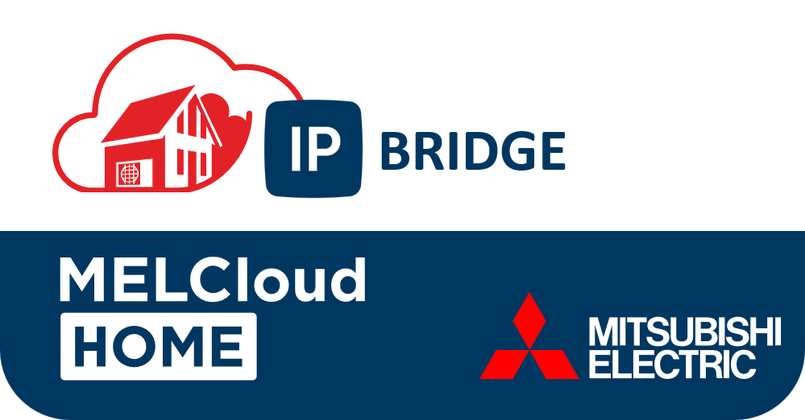
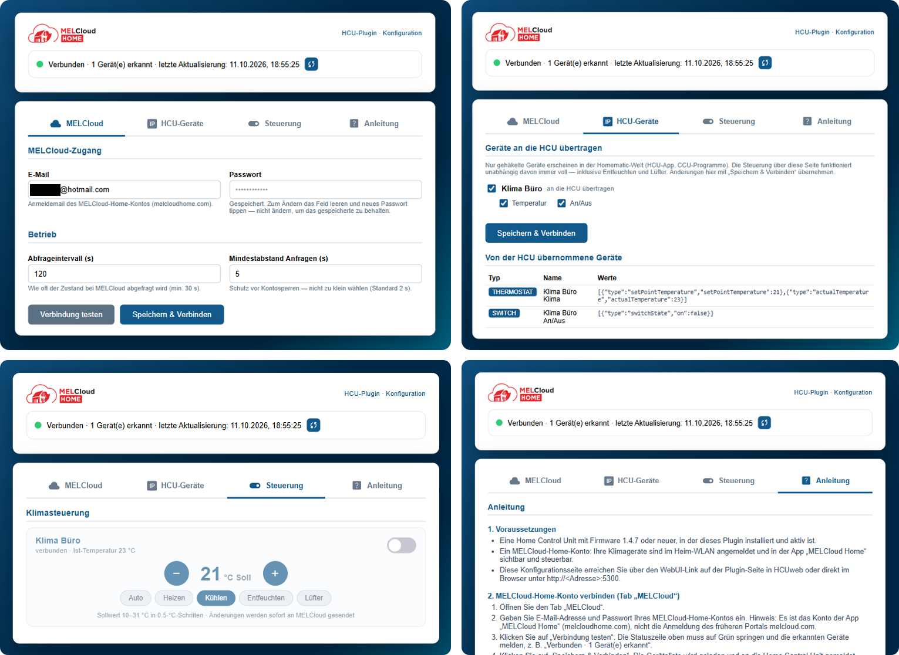

# MELCloud Home IP Bridge

**Homematic-IP-Plugin (Connect API), das Mitsubishi-Klimageräte aus MELCloud Home in die
Homematic-Welt bringt — Home Control Unit (HCU) 1.4.7+.**

Plugin-ID: `de.community.homematic.plugin.melcloud` · Lizenz: MIT · Status: Beta

> **Inoffizielles Community-Projekt.** Dieses Plugin steht in keiner Verbindung zu
> Mitsubishi Electric oder der Pepperl+Fuchs GmbH / Home Control Unit (EQ3). „MELCloud",
> „MELCloud Home" und „Mitsubishi Electric" sind Marken der Mitsubishi Electric Europe B.V.;
> „Homematic", „Homematic IP" und die HCU sind Marken der Pepperl+Fuchs GmbH bzw. EQ3.
> Die Logos dienen ausschließlich der Kennzeichnung der kompatiblen Dienste.

---

## Funktionen

| In der Homematic-Welt (App/CCU) | Feature | MELCloud |
|---|---|---|
| `<Name> Klima` — THERMOSTAT | Solltemperatur setzen/lesen, Ist-Temperatur | `SetTemperature`, `RoomTemperature` |
| `<Name> An/Aus` — SWITCH | Ein/Aus schalten und Status | `Power` |

Zusätzlich bietet die **eingebaute WebUI** des Plugins (Port 5300) die volle Steuerung,
die der Homematic-Gerätebaukasten nicht abbildet:

- Betriebsarten **Auto / Heizen / Kühlen / Entfeuchten / Lüfter** (die Homematic-App
  kennt für Plugin-Geräte nur Auto/Heizen/Kühlen — HEAT_PUMP als Archetyp verlangt zudem
  feste Partnerverbindungen und ist als reiner Modus-Umschalter unbrauchbar)
- Direktes Setzen ohne Umweg über die Homematic-App
- Auswahl, welche Geräte an die HCU übertragen werden (je Innengerät und je Gerätetyp)
- Live-Status (Ist-Temperatur, Betriebsart, Verbindung) und manueller Sofort-Abgleich

**Hinweise / Grenzen (durch MELCloud bzw. die Connect API vorgegeben):**

- Die MELCloud-Home-API ist eine **nicht öffentlich dokumentierte Cloud-API** des
  Herstellers; sie kann sich jederzeit ändern. Nutzung auf eigenes Risiko.
- wer das Gerät mit der **Infrarot-Fernbedienung** ausschaltet, synchronisiert das
  MELCloud nicht in die Cloud — der HCU-Status kann dann von der realen abweichen
- Sollwertgrenzen/Schritte je Gerät aus den MELCloud-Capabilities (typisch 10–31 °C, 0,5°)
- nur Klimaanlage (ATA) — Wärmepumpen (ATW/Ecodan) werden erkannt, aber nicht abgebildet

## Voraussetzungen

- Home Control Unit (HCU) ab Firmware **1.4.7** mit aktiver Connect API (Entwicklermodus)
- MELCloud-Home-Konto mit mindestens einem Klimagerät + Internetzugang zur HCU
- Für den Betrieb als Plugin-Container: Docker/Podman für den ARM64-Build oder
  fertig gebautes `.tar.gz` für HCUweb

## Schnellstart

### 1. Connect-API-Token holen (einmalig)

1. HCUweb → **Einstellungen → Control Unit → Entwicklermodus** aktivieren
2. ebenda einen **Aktivierungsschlüssel** erzeugen (verfällt nach kurzer Zeit — sofort verwenden)
3. Token anfordern und bestätigen — wahlweise:
   - über das mitgelieferte Tool: `node ..\tools\hcu-token.js --hcu hcu1-e60b.local --plugin de.community.homematic.plugin.melcloud --name "MELCloud Home" --key AKTIVIERUNGSSCHLUESSEL --out plugin\TOKEN`
   - oder HTTP: `POST https://<hcu>:6969/hmip/auth/requestConnectApiAuthToken`
     (Header `VERSION: 12`) und danach `POST .../confirmConnectApiAuthToken`
4. Das Token liegt als Datei `plugin/TOKEN`

### 2. Plugin starten

**Lokal (Tests, ohne Docker):** Node.js ≥ 20, dann

```powershell
cd HCU_Plugin_MelcloudHome
npm install --prefix plugin
node plugin\src\index.js de.community.homematic.plugin.melcloud <hcu-host>.local plugin\TOKEN
```

**Als HCU-Plugin (produktiv):**

```powershell
.\build.ps1     # erzeugt Plugin-Archiv .tar.gz (ARM64); Docker-Daemon muss laufen
```

Dann in **HCUweb die Plugin-Seite** öffnen und das Plugin-Paket (`.tar.gz`) dort hochladen/
installieren. Das Plugin erhält automatisch ein eigenes Token (`/TOKEN`
im Container); ein manuell erzeugtes TOKEN wird dann nicht benötigt.

### 3. Konfigurieren

WebUI `http://<hcu>:5300/config` (lokal: `http://localhost:5300/config`) öffnen,
MELCloud-Zugangsdaten (E-Mail + Passwort des **MELCloud-Home**-Kontos, nicht des alten
melcloud.com) speichern, ggf. Übertragung je Gerät an/aus — fertig. Der Erststart braucht
einen erfolgreichen MELCloud-Login; Zugangsdaten und Cloud-Tokens bleiben ausschließlich in
der Plugin-Datenbank (`/data/config.json`, `/data/tokens.json`, Rechte 0600).

## Projektstruktur

```
HCU_Plugin_MelcloudHome/
├── Dockerfile            # ARM64-Image + Plugin-Metadaten-Label (inkl. Base64-Logo)
├── build.ps1             # Build -> .tar.gz fuer HCUweb
├── LICENSE               # MIT
├── plugin/
│   ├── package.json      # Runtime: ws, uuid (beide MIT)
│   ├── TOKEN             # Connect-API-Token (lokal; nicht einchecken)
│   └── src/
│       ├── index.js         # Einstieg: Polling, WebUI, HCU-Callbacks
│       ├── hcuClient.js     # Connect-API-WebSocket-Client
│       ├── deviceMapper.js  # MELCloud -> Homematic-Archetypen (+Delta-Events)
│       ├── melcloudAuth.js  # PKCE/Cognito-Login + Refresh
│       ├── melcloudClient.js# /context + PUT /monitor/ataunit (Pacing)
│       ├── config.js        # Persistenz + CONFIG_TEMPLATE
│       ├── webui.js         # eingebautes Konfigurations-/Steuer-Frontend
│       └── logger.js
├── docs/KONZEPT.md       # Design-Entscheidungen, Archetyp-Analyse
├── dev/                  # Hilfs-/Pruefskripte (WebUI-Check, Inspektion, …)
└── tools/hcu-token.js    # Standalone-CLI fuer Aktivierungsschluessel -> TOKEN
```

## Rechtliches

- **Code:** MIT-Lizenz (siehe [LICENSE](LICENSE)). `package.json` deklariert dieselbe Lizenz.
- **Abhängigkeiten:** `ws` (MIT), `uuid` (MIT) — geprüft gegen die installierten Pakete.
  Beide werden unverändert mitgeliefert; die Lizenztexte liegen in
  `plugin/node_modules/<pkg>/LICENSE` und sind bei Weitergabe des Quelltextes
  mitzuführen (bei Docker-Images ohnehin an Bord).
- **Basis-Image:** `ghcr.io/homematicip/alpine-node-simple` (Alpine-Pakete:
  überwiegend MIT/BSD; Node.js: MIT). Für die Weitergabe des fertigen Images genügt der
  Hinweis hierauf.
- **Markenrechte:** siehe Disclaimer oben — das Logo darf nur die Kompatibilität
  kennzeichnen, keine unternehmerische Zugehörigkeit oder Zustimmung des Herstellers
  vortäuschen. Bei Veröffentlichung in einem
  Plugin-Store ggf. „inoffiziell" in den Beschreibungstext aufnehmen (ist im
  Docker-Metadaten-Label so vorgesehen).
- **Datenschutz:** Es werden ausschließlich eigene MELCloud-Zugangsdaten und die eigene
  HCU-Adresse verarbeitet; Speicherung nur lokal im Plugin-Datenverzeichnis. Keine
  Weitergabe an Dritte, keine Telemetrie.
- **MELCloud-Nutzungsbedingungen:** Die verwendete API ist nicht öffentlich freigegeben.
  Private Nutzung ist unproblematisch, kommerzielle Weiterverbreitung/Weiterverkauf des
  Plugins mit den MELCloud-Marken ist **nicht** zulässig.

## Haftungsausschluss

Die Nutzung erfolgt auf eigene Gefahr. Falsche Steuerbefehle an Klimaanlage,
Netzwerkkonfiguration oder HCU können Schäden verursachen. Der Autor übernimmt keine
Haftung für Personen-, Sach- oder Datenschäden.

## Oberfläche


