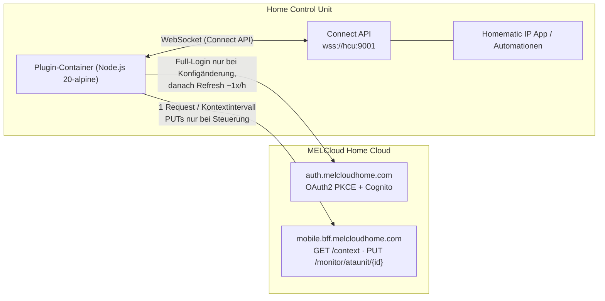
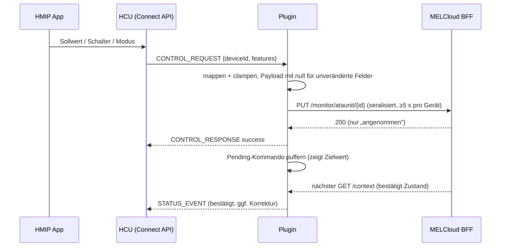

# Konzept: HCU-Plugin „Mitsubishi MELCloud Home"

> Stand: 2026-10-03 · Connect-API-Dokumentation 1.0.1 · API-Spike erfolgreich (Konto verifiziert)

## 1. Ziel

Brückt **MELCloud-Home**-Geräte (Mitsubishi Klima/Luft-Wasser) in die Homematic IP Home Control Unit (HCU):

- Anzeige von Ist-Temperatur, Soll-Temperatur, An/Aus und Betriebsart in der Homematic IP App
- Steuerung (Ein/Aus, Sollwert, Betriebsart) aus der Homematic IP App / CCU-Automationen
- Polling-basiert (Phase 2 optional WebSocket-Push)
- Konfiguration über das HCUweb-Formular (CONFIG_TEMPLATE der Connect API)
- Referenz-Architektur: `HCU_Plugin_SonnenBatterie` (WebSocket-Connect-API-Plugin, Docker)

**Kein Ziel in V1:** Lüfterstufen, Swing/Lamellen, Betriebsarten Dry/Fan, Zeitprogramme, Szenen — die Connect API 1.0.1 kann diese Konzepte nicht ausdrücken (kein Feature für FanSpeed/Vane; `ClimateOperationType` kennt nur AUTO/COOLING/HEATING).

## 2. Verifizierte Ist-Daten (API-Spike, 2026-10-03)

Nur-lesender Spike (`spike/spike.js`, ~13 Requests, keinerlei Steuerbefehle):

| Fakt | Ergebnis |
|---|---|
| Kontotyp | **MELCloud Home** (OAuth2 PKCE + AWS Cognito) — Login funktioniert headless |
| Token | `access_token` 3600 s, `refresh_token` vorhanden |
| Gebäude | 1 („Essers", Europe/Berlin) |
| ATA-Geräte | **1**: „Büro" (`id=aa6ea989-…`, `fourthGenWifi`, verbunden, RSSI −30) |
| ATW-Geräte | keine → V1 muss kein ATW abbilden |
| Zustandsformat | `settings[]` = Array aus `{name, value}` mit **PascalCase-Namen, String-Werten** (nicht `state{}` aus der Doku!) |
| Capabilities „Büro" | Heat 10–31 °C, Cool/Dry/Auto 16–31 °C, halbe Grad, 5 Lüfterstufen, Dry+Auto ja, Swing/Lamellen ja, Standby ja, `hasEnergyConsumedMeter: true`, aber `isEnergyUsageCompatible: false` |

Abgeleitete Pflicten für den Parser:

- Werte sind Strings und zu konvertieren: `"Power": "False"`, `"SetTemperature": "21"`, `"RoomTemperature": "23.5"`
- Namen als Key-Value-Feld, nicht als Objekt → `Object.fromEntries(settings.map(s => [s.name, s.value]))`
- Steuer-Payload (PUT) ist **camCase** (`power`, `operationMode`, `setTemperature`), Lesen ist **PascalCase** — beide Richtungen explizit mappen
- Anzeigename = `givenDisplayName` (Feld `name` existiert nicht)

## 3. MELCloud-Home-API (Grundlagen)

| | |
|---|---|
| Data-Base | `https://mobile.bff.melcloudhome.com` |
| Auth-Base | `https://auth.melcloudhome.com` (IdentityServer) + Federations-Login über AWS Cognito (`live-melcloudhome.auth.eu-west-1.amazoncognito.com`) |
| Auth-Flow | OAuth2 Authorization Code + PKCE (S256), `client_id=homemobile`, `redirect_uri=melcloudhome://`, PAR (`/connect/par`) → `/connect/authorize` → `Account/Login` → `ExternalLogin/Challenge?scheme=cognito-meu` → Cognito `/login` (POST mit `_csrf`) → `signin-oidc-meu` → `ExternalLogin/Callback` → `Redirect` → `/connect/authorize/callback` → `/connect/token` |
| Geräte + Zustand | **ein** `GET /context` liefert alles: Gebäude, ATA-Einheiten inkl. `settings[]`, `capabilities`, Verbindungsstatus |
| Steuerung ATA | `PUT /monitor/ataunit/{unit_id}` — Teil-Updates, `null` = unverändert; 200 = „angenommen", neuer Zustand erst im nächsten `/context` |
| Betriebsarten | `Heat`, `Cool`, `Automatic`, `Dry`, `Fan` (Achtung: „Automatic", nicht „Auto") |
| Energie | `GET /telemetry/telemetry/energy/{unit_id}` (Phase 2) |
| Realtime | `wss://ws.melcloudhome.com` (Phase 2, optional) |
| Vorbild-Pacing | HA-Integration `andrew-blake/melcloudhome`: 0,5 s Mindestabstand, 60 s Polling, 30 min Energie — hunderte Nutzer ohne Kontosperren |

## 4. Architektur

### Module (Muster = Referenz-Plugin sonnenBatterie)

| Datei | Aufgabe |
|---|---|
| `src/index.js` | Bootstrap, Poll-/Refresh-Loop, Readiness-Verwaltung |
| `src/hcuClient.js` | WebSocket zur Connect API: HANDSHAKE (authtoken + plugin-id), Reconnect (exponentiell 2→30 s), Envelope `{id, pluginId, type, body}`, Dispatcher, `knownDeviceIds`-Gate für STATUS_EVENT |
| `src/melcloudAuth.js` | PKCE-Flow (wie Spike), Cognito-CSRFP-Login, Token-Persistenz + Refresh |
| `src/melcloudClient.js` | REST-Client mit **zentralem Request-Pacer** (Queue, 1 Request gleichzeitig, Mindestabstand), `fetchContext()`, `putAtaUnit()`, Backoff |
| `src/deviceMapper.js` | `/context` → HCU-Geräte und -Status-Features, Delta-Erkennung |
| `src/config.js` | CONFIG_TEMPLATE (WebUI), Validierung, Persistenz `/data/config.json` |
| `src/logger.js` | JSON-Logging (stdout) |

Plugin-ID: `de.community.homematic.plugin.melcloud` · Basis-Image `ghcr.io/homematicip/alpine-node-simple` (linux/arm64) · Metadata-Label `de.eq3.hmip.plugin.metadata` · Deployment: `docker save | gzip` → `.tar.gz` → HCUweb-Upload.

## 5. Geräte-Mapping (V1, final: ohne Betriebsarten-Gerät)

Pro ATA-Innengerät entstehen **zwei** Plugin-Geräte (IDs stabil: `mc-{unitId}-…`):

| HCU-Gerät | DeviceType | Features (R=Read, W=via CONTROL_REQUEST) | MELCloud-Feld |
|---|---|---|---|
| `Büro Klima` | `THERMOSTAT` | `setPointTemperature` (W), `actualTemperature` (R) | `SetTemperature` (10–31 °C, 0,5-Schritte), `RoomTemperature` |
| `Büro An/Aus` | `SWITCH` | `switchState` (W) | `Power` |

Betriebsart wird **nicht** an die HCU übergeben: Der Archetyp `HEAT_PUMP` verlangt in der Homematic-App
zwei feste Partnerverbindungen (Wärmeerzeuger/-fläche) und ist als eigenständiger Modus-Umschalter
unbrauchbar (live geprüft, 04.10.2026). Moduswechsel bleiben dem Plugin-WebUI vorbehalten;
ein `CONTROL_REQUEST` mit `climateOperationMode` (z. B. von einer Alt-Aufnahme) wird trotzdem ausgeführt.

Mapping `climateOperationMode` ⇄ `OperationMode`:

| Connect API | MELCloud | Richtung |
|---|---|---|
| `HEATING` | `Heat` | R/W |
| `COOLING` | `Cool` | R/W |
| `AUTO` | `Automatic` | R/W |
| — | `Dry`, `Fan` | **nur Anzeige:** Feature wird gemeldet als zuletzt gültiger Modus bzw. `AUTO`; Steuerbefehle, die Dry/Fan erzeugen würden, sind nicht möglich (die App kann sie nicht senden) |

Hinweis Sollwert-Range: Grenzwerte kommen aus `capabilities` des Geräts ( Heat: 10–31, Cool/Dry/Auto: 16–31, halbe Grad). Das Plugin clamped Sollwerte vor dem PUT gegen die gerade gültige Betriebsart.

Nicht abgebildet (Connect-API-Limit): `SetFanSpeed`, `ActualFanSpeed`, `Vane*`, `InStandbyMode`, `ErrorCode` (optional: `maintenance`-Feature = `IsInError`, V1.1), Zeitprogramme, Szenen. ATW (`airToWaterUnits`): Phase 2, Schema analog (Zonen → THERMOSTAT, Warmwasser → HEAT_PUMP `hotWaterBoost`/`supplyTemperature`).

## 6. Steuerungsdatenfluss

- **Pending-Puffer:** Nach PUT gilt der Zielwert als erwartet; bestätigt der nächste `/context` ihn nicht innerhalb 3× Intervall, wird der real gelesene Wert gemeldet (kein Endlos-Retry).
- **Koaleszierung:** Mehrfache dieselben Werte innerhalb eines Fensters → nur 1 PUT. Unterschiedliche Features derselben Einheit werden bis zum nächsten Sendefenster zu **einem** PUT zusammengefasst (Partial-Update kann alles gleichzeitig).
- **Nie:** vertikale + horizontale Lamellen in einem Request (API-Bug, für V1 irrelevant).

## 7. Kommunikationsintervall & Lock-Schutz

| Regel | Wert | Begründung |
|---|---|---|
| Globaler Pacer | 1 Request gleichzeitig, Mindestabstand **2 s** (config, min 1 s) | HA-Integration fährt 0,5 s ohne Bans — wir sind 4×保守 |
| Kontextpolling | **60 s** Default (config, min 30 s), **1 Request total** unabhängig von Gerätezahl | `/context` liefert alle Geräte in einem Call |
| Steuersenden | ≥ 5 s pro Einheit, koalesziert | Nutzer-Tippflut wird gedämpft |
| Energie (`/telemetry/energy`) | V1 aus; Phase 2 optional, ≥ 30 min | `isEnergyUsageCompatible:false` am Testgerät klären |
| Report-Endpunkte | nie (nachweislich langsam/500er-anfällig) | Spike-Doku der HA-Integration |
| Full-Login | nur bei Konfigspeicherung / ungültigem Refresh-Token | Cognito-Login ist der teuerste Pfad |
| Token-Refresh | ~1×/h (60 s vor Ablauf, 401 → 1× Refresh) | Standard-OAuth |
| 429 / 5xx | Retry-After respektieren, sonst Backoff 60 s → 15 min → 1 h; max 3 Retries, dann Pause + CREATE_USER_MESSAGE (WARN) in der HCU | kein Retry-Sturm → kein Lock |
| Container-Neustart | refresh_token aus `/data/tokens.json` wiederverwenden | vermeidet Login-Bursts |
| Phase 2 WS-Push | bei Verbindung: Polling auf 300 s absenkbar | Requests weiter reduziert |

Damit Dauerlast ≈ **1 Request/Minute** — deutlich unter dem Verhalten der offiziellen MELCloud-App und der HA-Integration.

## 8. Konfiguration im WebUI (eingebetteter HTTP-Server, Muster = Rollladen-Referenzplugin)

Das Plugin stellt **eine eigene Konfigurationsseite** über einen eingebetteten HTTP-Server bereit
(Port **5300**, im Docker-Image `EXPOSE` — die HCU mappt exponierte Ports 1:1 ins LAN).
Aufruf: `http://<hcu-host>:5300`. Das HCUweb-Konfigurationsformular erhält als ersten Eintrag
nur den Link auf diese Seite (`__info_link`, dazu einfache Fallback-Felder):

| Bereich | Feld | Typ |
|---|---|---|
| Konto | E-Mail | TEXT |
| Konto | Passwort | PASSWORD (wird nie zurückgeliefert; leer = behalten) |
| Betrieb | Abfrageintervall (s) | NUMBER, min 30, Default 60 |
| Betrieb | Mindestabstand (s) | NUMBER, min 1, Default 2 |
| Geräte | *je nach `/context` gefundenes Gerät* ein Schalter „Anzeigen" | dynamisch nach erstem erfolgreichen Login |
| Status | Live-Status + Geräte-Vorschau (das, was die HCU erhält) | Auto-Refresh 5 s |

Persistenz: `/data/config.json` (ohne Passwort im Klartext? → Passwort braucht Derivation für Refresh; Ablage in `/data/tokens.json` mit Rechten 600, getrennt vom Config-Export). Ready-Zustände: `CONFIG_REQUIRED` (Zugang fehlt) → `ERROR` (Login/API) → `READY`; Wechsel proaktiv via PLUGIN_STATE_RESPONSE; Auth-Fehler + wiederholte API-Fehler via CREATE_USER_MESSAGE (de/en).

## 9. Phasenplan

| Phase | Inhalt |
|---|---|
| **0 Spike** ✅ | Login + `/context` verifiziert (dieses Dokument, `spike/spike.js`) |
| **1 Grundgerüst** | Docker, hcuClient, config/WebUI, Readiness — Plugin erscheint in HCUweb |
| **2 Abbildung** | deviceMapper: THERMOSTAT + SWITCH je ATA, Polling, STATUS_EVENT-Deltas |
| **3 Steuerung** | CONTROL_REQUEST → PUT, Pending/Bestätigung, CONTROL_RESPONSE; Betriebsarten-Gerät (HEAT_PUMP) |
| **4 Feinschliff** | User-Messages, maintenance-Fehler-Feature, Doku, `.env`-freier Betrieb |
| Phase 5 (später) | WS-Push, Energie-Gerät, ATW, mehrere Gebäude/Gast-Zugang |

## 10. Offene Verifikationspunkte (am echten HCU)

1. **Schreibrechte pro Archetyp:** Verhält sich `THERMOSTAT.setPointTemperature` / `SWITCH.switchState` / `HEAT_PUMP.climateOperationMode` in der App tatsächlich als CONTROL_REQUEST-Absender (Doku beschreibt Control generisch).
2. Darstellung, wenn `climateOperationMode` den Wert für Dry/Fan nicht sauber abbildet (Feature weglassen vs. AUTO melden) — am echten HCU testen.
3. `WEBLINK`-Pflicht für `url` im Metadata-Label (sonnen nutzt `https://sonnen.de`; hier z. B. `https://my.melcloudhome.com`).
4. Max. Anzahl Geräte/Features pro Plugin auf kleiner HCU — unkritisch bei 3 Geräten, aber beobachten.
